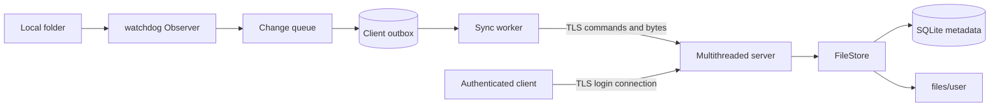
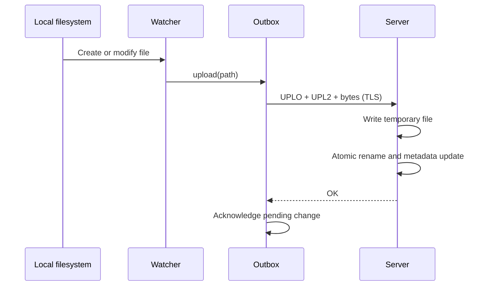

# Architecture

The service uses a multithreaded server and a dedicated synchronization
connection from each client. Client connections are encrypted with TLS; the
server refuses plaintext clients.

## Client

`SyncWorker` watches the configured local folder recursively. `ChangeHandler`
converts filesystem events into queue entries:

- created and modified files become uploads;
- deleted files become delete operations;
- moved files become a delete followed by an upload;
- created and deleted directories become directory operations.

Before an operation is executed, it is written to a SQLite outbox. If the
client exits or the connection drops, pending operations are retried after
restart. The worker coalesces repeated events for the same path and waits for
the file size and modification time to stabilize before uploading.

`ClientSession` owns the TLS socket, buffered protocol reader, login,
registration, manifest, upload, download, and password commands. `cli_fich.py`
uses one session for the interactive login and `SyncWorker` opens a second
authenticated session for background synchronization.

## Server

`ServerRuntime` accepts TLS connections and starts one session thread per
client. `FileStore` owns the filesystem and the SQLite database:

- `users` stores PBKDF2 password hashes and roles;
- `files` stores `(owner, path, rev, hash, size, mtime_ns, deleted)`;
- `shares` stores `ro`/`rw` grants between users;
- `settings` stores server-side flags such as registration.

Uploads are received into a temporary file and moved into place with an atomic
rename. Paths are normalized and checked with symlink-aware resolution so they
cannot escape the user's storage directory. Deletes leave tombstones so a
client can propagate them during reconciliation.

## Data flow

## Configuration and TLS

`config.py` loads TOML and environment overrides. The server requires
`TLS_CERT_FILE` and `TLS_KEY_FILE`; the client verifies certificates with the
system trust store or `CLIENT_TLS_CA_FILE`. See [Security](security.md).
