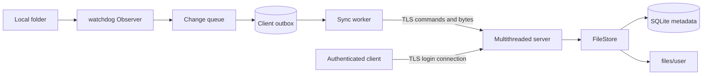
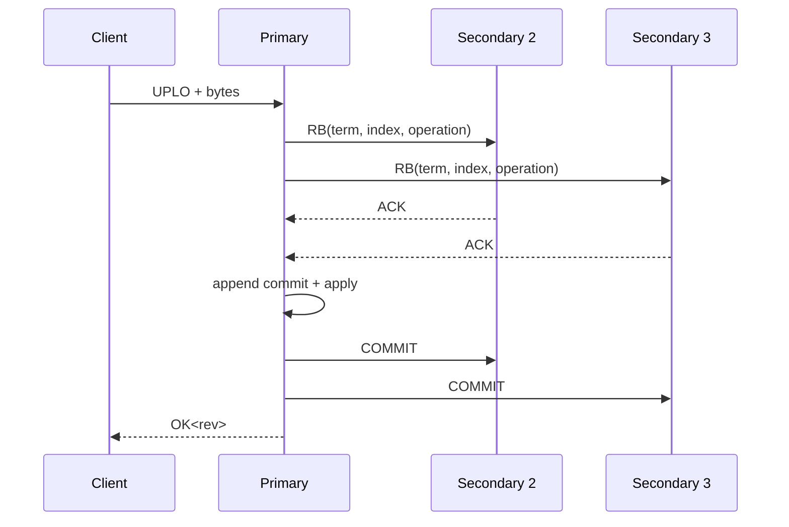
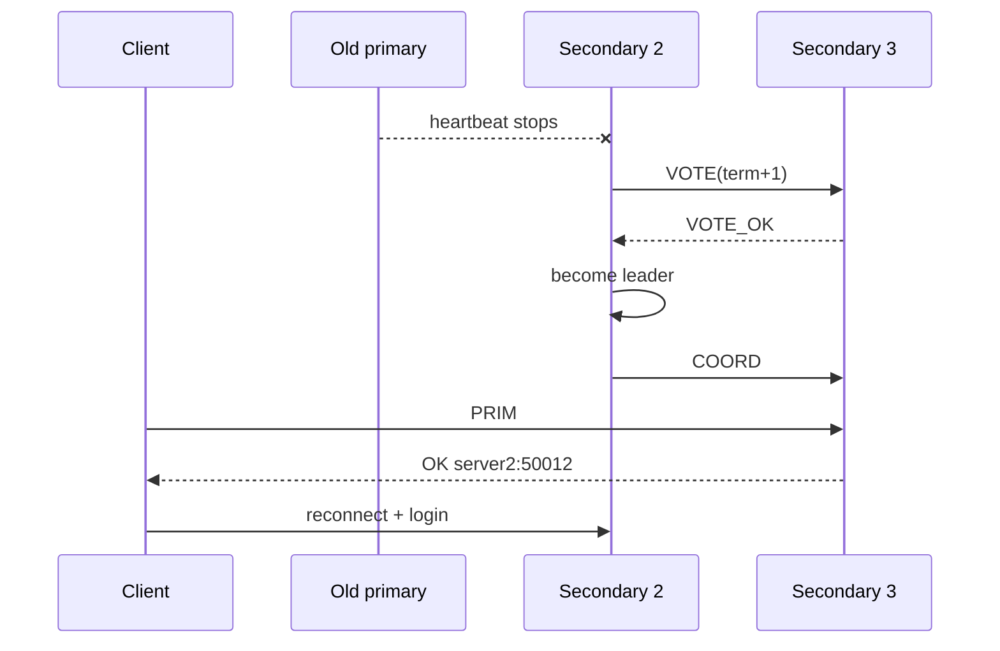
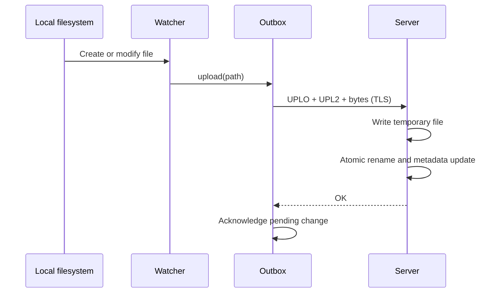

# Architecture

The service uses a multithreaded server and a dedicated synchronization
connection from each client. Client connections are encrypted with TLS; the
server refuses plaintext clients.

## Desktop client process

The desktop GUI is a Tkinter frontend. It starts a per-user background daemon
that owns `SyncWorker`, `RemoteWatcher`, and the management `ClientSession`.
GUI and CLI communicate with the daemon over a local Unix socket or Windows
named pipe using `multiprocessing.connection`; an authkey file with mode `0600`
protects the channel. Closing the GUI hides it to the tray, while the tray
**Quit** action stops both the GUI and the daemon.

The daemon keeps credentials only in memory. Settings live in the standard
per-user configuration directory. A single-instance lock prevents two daemons or
two GUIs from running against the same state.

## Client

`SyncWorker` watches the configured local folder recursively. `ChangeHandler`
converts filesystem events into queue entries:

- created and modified files become uploads;
- deleted files become delete operations;
- moved files become a delete followed by an upload;
- created and deleted directories become directory operations.

Before an operation is executed, it is written to a SQLite outbox. If the
client exits or the connection drops, pending operations are retried after
restart. At startup the client reconciles the server manifest with the last
known state and the local filesystem: it uploads new or locally modified files,
downloads new or remotely modified files, applies tombstones, and preserves
both versions when local and remote content changed. The watcher starts after
this reconciliation. The worker coalesces repeated events for the same path and
waits for the file size and modification time to stabilize before uploading.

`ClientSession` owns the TLS socket, buffered protocol reader, login,
registration, manifest, upload, download, and password commands. `cli_fich.py`
uses one session for the interactive login and `SyncWorker` opens a second
authenticated session for background synchronization.

## Server

`ServerRuntime` accepts TLS connections and starts one session thread per
client. `FileStore` owns the filesystem and the SQLite database:

- `users` stores PBKDF2 password hashes and roles;
- `files` stores `(owner, path, rev, hash, size, mtime_ns, deleted)`;
- `shares` stores `ro`/`rw` grants between users;
- `settings` stores server-side flags such as registration.

Uploads are received into a temporary file and moved into place with an atomic
rename. Paths are normalized and checked with symlink-aware resolution so they
cannot escape the user's storage directory. Deletes leave tombstones so a
client can propagate them during reconciliation. A stale upload or delete
preserves the current server version as a conflict copy named
`<stem> (conflict <client id> <timestamp>)<suffix>` and returns its path to the
client.

## Shared files and notifications

A user can share a file or directory with another active user as `ro` or `rw`.
The owner always has implicit `rw`; self-shares and `anonimous` grantees are
rejected. Shares are stored in the replicated `shares` table.

On the client, owned files stay at the root and shared files are mounted under
`shared/<owner>/<path>`. `ClientState` records the owner, path, and access.
`ro` local edits are preserved as local conflict copies and the remote version
is restored; `rw` changes follow the normal conflict rules.

The primary keeps a `NotificationHub` with one subscription per `SUBS`
connection. After a committed mutation, it sends `UPDT` to the owner and to
matching grantees, excluding the originating `client_id`. The client
`RemoteWatcher` keeps a separate TLS subscription connection, enqueues updates
into `SyncWorker`, and triggers a full reconciliation after reconnecting. Share
creation/revocation sends `S`/`R` so the grantee adds or removes local copies.

## Administration panel

`AdminService` validates administrative requests and commits them through the
same replicated mutation path as client operations. `AdminServer` serves the
TLS panel with server-side sessions, CSRF tokens, and HTML forms. It runs only
when `SERVER_ADMIN_ENABLED=true`; secondary nodes show status and redirect
mutations to the primary admin URL.

## Replication

The primary plans each mutation as deterministic operations: file writes include
the exact revision, hash, size, `mtime_ns`, conflict copy name, and base64 data.
It broadcasts the operation to the secondaries over mutual TLS, waits for a
2/3 quorum, appends the committed entry to its durable log, applies it locally,
and sends `COMMIT`. Secondaries store proposals in their own log and apply only
committed entries in order.

If a majority is not available, the primary sends `ABORT`, does not apply the
operation, and returns `ER12`. Secondaries reject client mutations with `ER13`;
reads and login are served from their local replicated state.

## Election and failover

Every node runs a `ClusterNode`. The leader sends `HB` heartbeats every
`HEARTBEAT_INTERVAL`; a follower that sees no heartbeat for
`FAILURE_TIMEOUT` starts an election. A candidate increments the term, votes for
itself, and requests votes from its peers. A voter grants its vote only when the
candidate's `(last_term, last_index)` is at least as recent as its own. A
majority elects the new leader, which announces itself with `COORD`.

Any higher term fences the old leader: it becomes a follower, clears its vote,
and rejects client mutations on the next command. A leader that cannot reach a
majority of `HB_OK` also steps down.

When a restarted node is behind, the leader compares `commit_index` during
heartbeats and sends `SNAP`. The rejoining node imports the snapshot and resets
its log to the snapshot term/index.

## Data flow

## Configuration and TLS

`config.py` loads TOML and environment overrides. The server requires
`TLS_CERT_FILE` and `TLS_KEY_FILE`; the client verifies certificates with the
system trust store or `CLIENT_TLS_CA_FILE`. See [Security](security.md).
