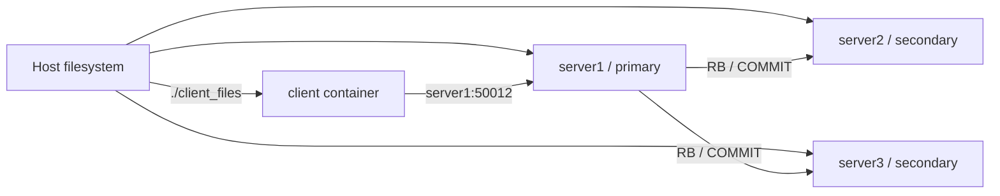

# Docker Deployment

Docker Compose runs three replicated servers and the automatic synchronization
client. `server1` is the primary; `server2` and `server3` are secondaries.



## Requirements

- Docker Engine with Compose v2.
- A free host port, `50012` by default.

## Create TLS certificates

The containers refuse plaintext connections and secondary replication uses
mutual TLS. Create the bind-mounted directories first so Docker does not create
them as root, then generate a development CA and a certificate valid for all
three service names:

```sh
mkdir -p files/server1 files/server2 files/server3 client_files certs
python -m pip install -r requirements-dev.txt
python scripts/generate_dev_cert.py --output certs \
  --host server1 --host server2 --host server3 \
  --host localhost --host 127.0.0.1
```

`compose.yaml` mounts `./certs` read-only into every container. For a real
deployment, replace these files with certificates from a public CA. See the
[Security guide](security.md).

## Configure permissions and cluster token

The containers use the host UID and GID for the bind-mounted data directories.
Create a local `.env` file from the example:

```sh
cp .env.example .env
sed -i "s/^DOCKER_UID=.*/DOCKER_UID=$(id -u)/; s/^DOCKER_GID=.*/DOCKER_GID=$(id -g)/" .env
```

Set a non-empty `CLUSTER_TOKEN` shared by all three servers. Set
`APP_PASSWORD_SAR` and `APP_PASSWORD_SZA` if authenticated bootstrap accounts
are required. `.env` is local configuration and must not be committed.

## Build the images

```sh
docker compose build
```

The server image contains the client protocol runtime and the replication
listener. The client image contains the authentication prompt and automatic
synchronizer based on `watchdog`.

## Use published images

The `main` branch publishes both images to GitHub Container Registry:

```text
ghcr.io/kingjorjai/distributed-systems-cloud-file-service-server:latest
ghcr.io/kingjorjai/distributed-systems-cloud-file-service-client:latest
```

To use a published version instead of building locally, use the registry
override and set the image prefix and tag:

```sh
export IMAGE_PREFIX=ghcr.io/kingjorjai/distributed-systems-cloud-file-service
export IMAGE_TAG=latest
docker compose -f compose.yaml -f compose.registry.yaml pull
docker compose -f compose.yaml -f compose.registry.yaml up -d server1 server2 server3
docker compose -f compose.yaml -f compose.registry.yaml run --rm client
```

Version tags such as `v1.0.0` are also published when pushed to GitHub.

## Downloadable standalone bundles

Pushing a tag such as `v1.0.0` also creates a GitHub Release with independent
server and client bundles for Windows x64 and Linux x64. Each bundle contains
the application executable, its Python runtime and dependencies,
`config.toml.example`, a short README, and an empty data directory.

The target machine does not need Python, `pip`, Docker, or an additional
dependency download. Choose the asset matching the operating system and
component, extract it, configure the environment variables or TOML file, and
run the executable from the extracted directory:

```text
cloud-file-service-server-windows-x64-v1.0.0.zip
cloud-file-service-client-windows-x64-v1.0.0.zip
cloud-file-service-server-linux-x64-v1.0.0.tar.gz
cloud-file-service-client-linux-x64-v1.0.0.tar.gz
```

The release also contains `SHA256SUMS` and a Compose package. Verify the
checksum before extracting an asset. Standalone bundles are built with
PyInstaller in folder mode; they are intentionally not a single executable so
that configuration, documentation, and data directories remain visible.

## Start the cluster

```sh
docker compose up -d server1 server2 server3
docker compose ps
docker compose logs -f server1
```

Only `server1` publishes its client port to the host. Inside the Compose
network the servers use `50012` for clients and `60012` for replication.
`SERVER_PUBLISHED_PORT` changes the host port; `SERVER_INTERNAL_PORT` changes
the internal client port. The replication port is fixed to `60012` in
`compose.yaml`.

Each server has its own volume: `files/server1`, `files/server2`, and
`files/server3`. The primary replicates mutations to the secondaries and waits
for a 2/3 quorum before confirming them. `server2` and `server3` list all peers
so they can elect a new primary if `server1` stops.

## Start the client

Run the client interactively from a second terminal:

```sh
docker compose run --rm client
```

The client uses `server1`, `server2`, and `server3` as seeds. It asks `PRIM` for
the current primary and redirects if necessary. It watches `/data`, which is
mapped to the host's `client_files/` directory. Authenticate with one of the
passwords configured in `.env`, then create or modify a file in
`client_files/` on the host. It should appear under the primary's
`files/<server>/<user>/` directory and be replicated to the other servers.

## Shared files

Share a file or directory with another registered user as `ro` or `rw` through
the client API (`SHAR`/`UNSH`; the GUI arrives in M6). Grantees see shared paths
under `shared/<owner>/` in their local data directory. Active clients receive
`UPDT` notifications and download changes immediately; revoking a share removes
the grantee's local copy on the next notification or reconciliation.

## Administration panel

Compose enables the HTTPS admin panel on all three nodes. Open the primary at
`https://localhost:50080/` and log in with `sar` or `sza` using the passwords
from `.env`. `server2` and `server3` are available at `https://localhost:50081/`
and `https://localhost:50082/`; they are read-only and redirect mutations to
the current primary.

The development certificate is self-signed; import `./certs/ca.crt` into the
browser or accept the warning. Set `ALLOW_ADMIN_FAILOVER=0` outside the demo if
you do not want the step-down button.

## Demo failover

Keep the client container running or start it again. Stop the primary:

```sh
docker compose stop server1
```

Within a few seconds one of `server2`/`server3` becomes the new primary. Future
client commands use `PRIM` to redirect to it. Upload another file and confirm
that it appears in the new primary's data directory and in the other running
server.

Restart the old primary:

```sh
docker compose start server1
```

It rejoins as a follower, receives a snapshot from the current primary, and its
`files/server1` volume converges to the new state.

## Stop the services

```sh
docker compose down
```

The bind-mounted files remain on the host after containers stop. Use
`docker compose down --rmi local` to also remove the locally built images.

## Troubleshooting

If the client reports a certificate error, confirm that `./certs/server.crt`
contains the `server1` SAN and that `./certs/ca.crt` is mounted in every
container. Regenerate the certificate with the full host list above.

If the primary reports no quorum, check `docker compose ps` and the logs of
`server2` and `server3`. Replication requires the same `CLUSTER_TOKEN` and the
same CA in every container.

```sh
docker compose logs server1
docker compose logs server2
docker compose logs server3
```

If a bind-mounted directory is not writable, check `.env` and confirm that
`DOCKER_UID` and `DOCKER_GID` match `id -u` and `id -g` on the host.
