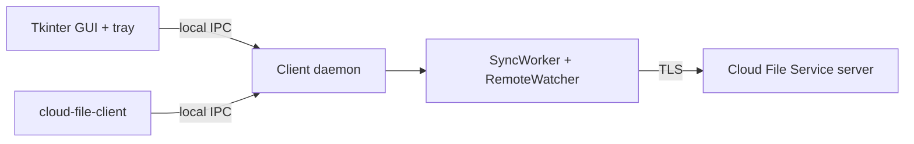

# Desktop Client

The desktop client is a Tkinter GUI that controls a background synchronization
daemon. The daemon owns the `watchdog` watcher, the TLS synchronization
connection, notifications, and the durable outbox. Closing the window hides the
GUI to the system tray; synchronization continues.



## Install

Download the self-contained release bundle for Windows x64 or Linux x64 and
extract it. No Python installation is required.

- Windows: run `cloud-file-client-gui.exe`. SmartScreen may warn because the
  bundle is not code-signed.
- Linux: run `./cloud-file-client-gui`; the bundle includes Tkinter. If the
  system reports missing Tk libraries, install the distribution's `python3-tk`
  package for local development, not for the bundle.

The CLI bundle is separate and connects to the same daemon.

## First run

1. Enter the server host/port or the cluster seed endpoints.
2. Choose a CA certificate if the server uses a private CA.
3. Choose the local folder.
4. Register a new account or log in.
5. Synchronization starts automatically.

The GUI never stores the password. The daemon keeps it in memory for
reconnections; after a daemon restart, log in again.

## Settings

Settings are stored in the standard per-user configuration directory:

- Windows: `%APPDATA%\CloudFileService\config.toml`
- Linux: `$XDG_CONFIG_HOME/cloudfs/config.toml` or `~/.config/cloudfs/config.toml`

`CONFIG_FILE` overrides the path. Environment variables still override TOML
values. The GUI can enable autostart at login; on Linux it writes
`~/.config/autostart/cloud-file-service.desktop`, and on Windows it writes the
current user's `Run` registry key.

## Shares

Shared files appear under `shared/<owner>/<path>`. The GUI lists shares where
the logged-in user is owner or grantee. Owners can create `ro`/`rw` shares and
revoke them. A grantee editing an `ro` copy keeps a local conflict copy while
the remote version is restored.

## Tray behavior

- Closing the window hides it to the tray.
- Tray menu: Show, Open folder, Pause/Resume, Quit.
- **Quit** stops the GUI and the daemon. Synchronization stops.
- If the tray cannot be created (for example on a minimal Linux desktop), the
  window is minimized instead.

## CLI

The CLI controls the same daemon:

```sh
cloud-file-client status
cloud-file-client login <usuario>
cloud-file-client shares
cloud-file-client share docs bob ro
cloud-file-client unshare docs bob
cloud-file-client pause
cloud-file-client resume
cloud-file-client quit
```

`cloud-file-client --foreground` runs a direct debug worker without the daemon.

## Troubleshooting

- **Daemon did not start:** check `%APPDATA%`/`$XDG_CONFIG_HOME` permissions and
  whether another instance holds `daemon.lock`.
- **Authentication/connection errors:** verify the server URL, CA, and that the
  server is the primary (the client follows `PRIM`).
- **Tray missing:** install the desktop's status-notifier/AppIndicator support;
  the GUI still works minimized.
- **Wrong folder:** save settings, then restart synchronization from the
  toolbar.
