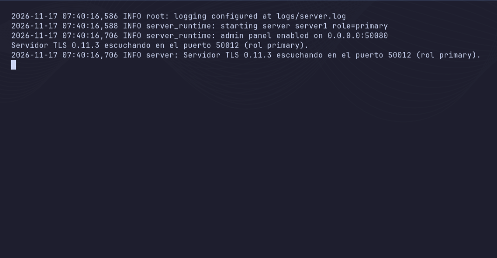
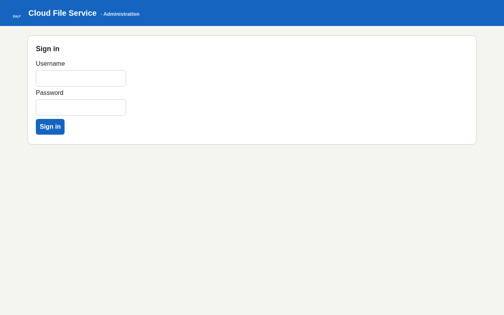
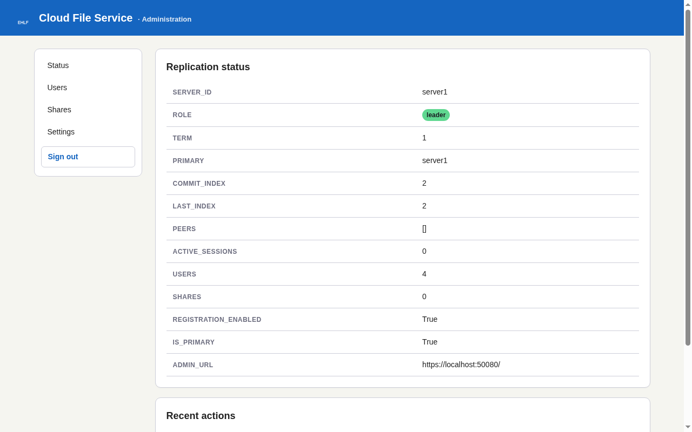
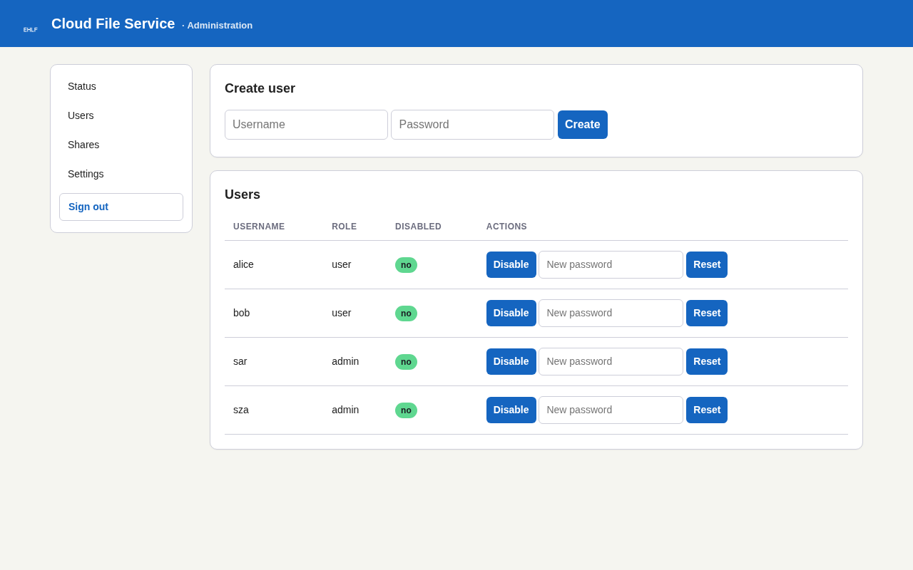
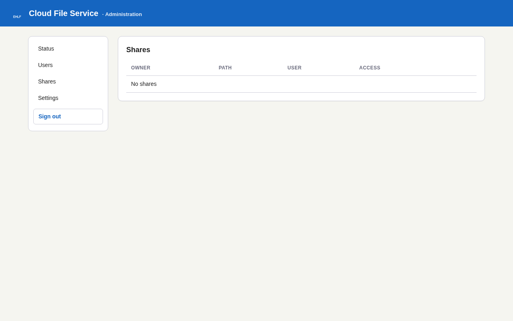
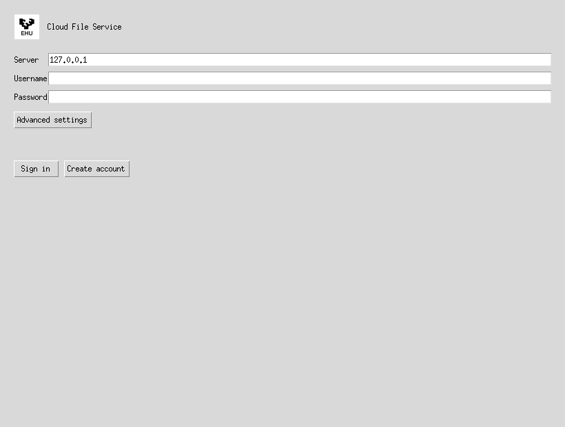
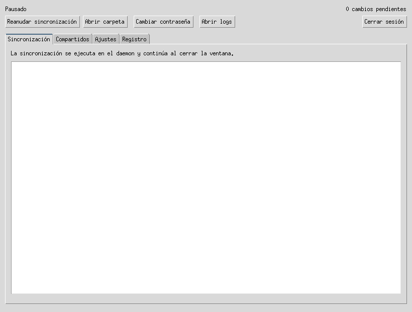
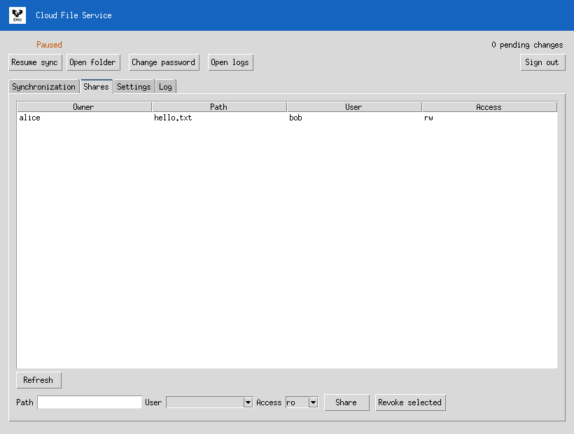
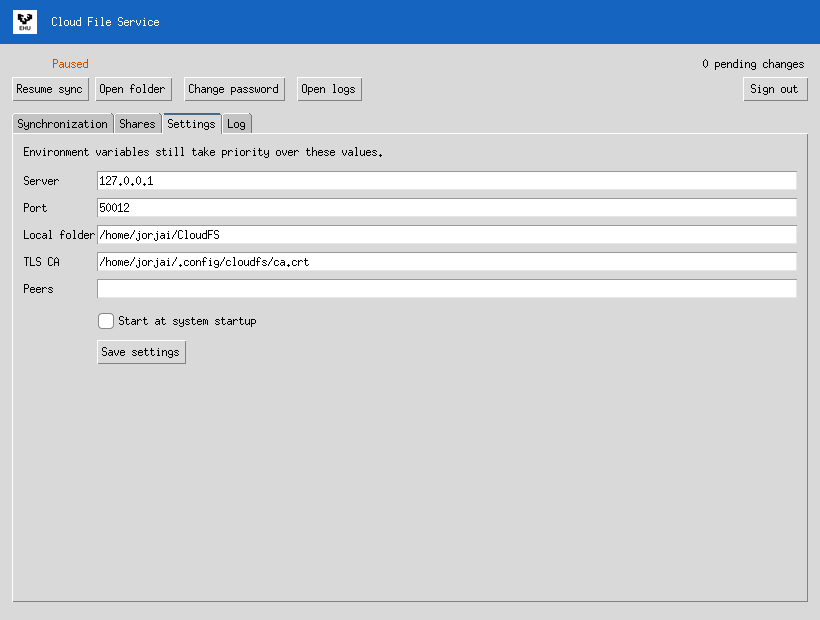
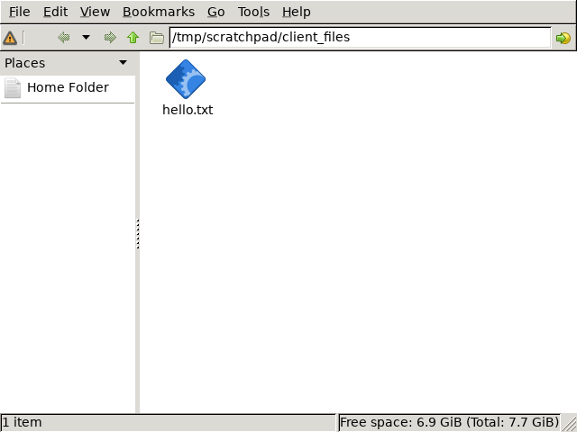

# Installation Guide

This guide installs Cloud File Service on Ubuntu 22.04. It needs no Internet
access after the ZIP archive and this guide are available. All commands are
copy-paste ready; replace the example IP addresses with the addresses of your
machines.

The guide offers two routes:

- **Path A - one machine.** About ten minutes. No root access, no systemd.
  Good for evaluating the product.
- **Path B - permanent install.** About one hour. systemd services, a
  dedicated user, and support for a replicated cluster of three or more
  machines. Choose this for a classroom or a small team.

Read Path A first even if you intend to use Path B: it explains the
concepts that Path B relies on.

## What you receive

Two ZIP archives, each below 25 MB so they can be sent by email:

- `CloudFS-Server-0.11.3-linux-x64.zip` - the server bundle, its
  configuration template, certificates, the systemd unit and the tools.
- `CloudFS-Client-0.11.3-linux-x64.zip` - the desktop client bundle, its
  configuration template, the CA certificate, the systemd unit and the tools.

Both archives contain the same single `cloudfs` executable. The server runs it
as `cloudfs server`; the desktop runs it as `cloudfs` (which opens the GUI).

Every archive also contains:

- `docs/installation.pdf` - this guide.
- `packaging/` - the systemd units and `make-certs.sh`.
- `README.txt` - the short version of this guide.

## Requirements

- Ubuntu 22.04 on every machine (desktop or server edition).
- No Internet access is required.
- The following tools are already present on Ubuntu 22.04:
  `python3`, `openssl`, `unzip` or `tar`, `curl`, `ss`.
  If `unzip` is missing, extract with `python3 -m zipfile -e file.zip .`.
- A browser on the machine from which you will open the admin panel.
- Fixed IP addresses or hostnames for the servers.

## Example layout (Path B)

| Node | Role | Example address |
| --- | --- | --- |
| `server1` | Primary | `192.168.1.101` |
| `server2` | Secondary | `192.168.1.102` |
| `server3` | Secondary | `192.168.1.103` |
| `client1` | `alice` | `192.168.1.111` |
| `client2` | `bob` | `192.168.1.112` |

Path A uses `127.0.0.1` for everything.

The quorum for `N` servers is `floor(N / 2) + 1`:

- 1 server: standalone, no failover.
- 2 servers: quorum 2, so there is **no** failover when one stops.
- 3 servers: recommended for a demonstration.
- More than 3: supported, use an odd number.

# Path A - one machine

## A.1 Extract

```sh
mkdir -p ~/CloudFS && cd ~/CloudFS
unzip /path/to/CloudFS-Server-0.11.3-linux-x64.zip -d server
unzip /path/to/CloudFS-Client-0.11.3-linux-x64.zip -d client
```

## A.2 Start the server

```sh
cd ~/CloudFS/server
./start-server.sh
```

Expected output:

```text
TLS server 0.11.3 listening on port 50012 (role primary).
```

The script sets `CONFIG_FILE`, creates `server/files` and prints the bootstrap
administrator password. Keep that terminal open; the server runs in the
foreground.

## A.3 Open the client

In a second terminal:

```sh
cd ~/CloudFS/client
./cloudfs
```

The GUI opens. Register a new account or log in with an account created from
the admin panel. The client synchronizes `client_files` with the server.

## A.4 Open the admin panel

Open `https://localhost:50080/` in a browser. Log in as `sar` with the
password printed by `start-server.sh`. You can create users, share folders and
inspect the cluster.

## A.5 Stop

Press `Ctrl+C` in the server terminal. The client can be closed from its
window; it hides to the taskbar or minimizes if no tray is available.

# Path C - laboratory (no sudo, replicated cluster)

Use this path when you have no root access and want a replicated cluster
for the demonstration. Everything runs from your home directory; there is no
systemd and no permanent installation.

## C.1 Choose ports

If all three servers run on one machine, give each a different port set:

| Node | Client port | Replication port | Admin port |
| --- | --- | --- | --- |
| `server1` | `50012` | `60012` | `50080` |
| `server2` | `50013` | `60013` | `50081` |
| `server3` | `50014` | `60014` | `50082` |

If each server runs on its own machine, use the default ports (`50012`,
`60012`, `50080`) on every node and replace `127.0.0.1` with the real IP.

## C.0 Offline kit (single machine, no sudo)

If you only need one machine for evaluation, use the offline kit instead of
Path C. It is a single ZIP that contains the server, the desktop client, the
CA, configuration, logs, and a no-terminal launcher:

```sh
# Already included in the kit; no build step needed.
unzip CloudFS-Offline-0.11.3-linux-x64.zip -d ~/CloudFS
cd ~/CloudFS
./server/start-server.sh        # terminal 1
./cloudfs                      # terminal 2 (or double-click)
```

The kit's certificates are generated for `localhost` and `127.0.0.1`. If the
server must be reachable from other machines, regenerate the certificates
inside the extracted kit:

```sh
cd ~/CloudFS
bash packaging/tools/make-certs.sh --out server/certs \\
    --host 192.168.1.101 --host 192.168.1.102 --host 192.168.1.103 \\
    --host localhost --host 127.0.0.1
cp server/certs/ca.crt client/certs/ca.crt
```

No root access and no Internet are required. The `packaging/` folder inside
the kit contains the same `make-certs.sh` and systemd units referenced in
Path B.

## C.2 Certificates

Generate one CA and one server certificate with every server address as a SAN:

```sh
cd ~/CloudFS
bash packaging/tools/make-certs.sh --out certs \\
    --host 127.0.0.1 \\
    --host 192.168.1.101 \\
    --host 192.168.1.102 \\
    --host 192.168.1.103 \\
    --host localhost
```

Copy `certs/` to every server folder. Copy only `certs/ca.crt` to every
client folder.

## C.3 Server folders

Create one folder per node:

```sh
mkdir -p ~/CloudFS/server1 ~/CloudFS/server2 ~/CloudFS/server3
for n in 1 2 3; do
    cp -a ~/CloudFS/server/cloud-file-server/. ~/CloudFS/server$n/
done
```

## C.4 Server configuration

Create `~/CloudFS/server1/config.toml`:

```toml
[server]
host = "0.0.0.0"
port = 50012
files_path = "files"
tls_cert_file = "certs/server.crt"
tls_key_file = "certs/server.key"
tls_ca_file = "certs/ca.crt"
registration_enabled = true
server_id = "server1"
role = "primary"
peers = "server2@127.0.0.1:60013,server3@127.0.0.1:60014"
primary = ""
replication_host = "0.0.0.0"
replication_port = 60012
cluster_token = "change-this-secret"
term = 1
replication_timeout = 2.0
heartbeat_interval = 0.5
failure_timeout = 2.0
election_timeout = 1.0
client_addresses = "server1@127.0.0.1:50012,server2@127.0.0.1:50013,server3@127.0.0.1:50014"
admin_enabled = true
admin_host = "0.0.0.0"
admin_port = 50080
admin_addresses = "server1@127.0.0.1:50080,server2@127.0.0.1:50081,server3@127.0.0.1:50082"
allow_admin_failover = true
admin_session_timeout = 3600.0
```

For `server2`, change `server_id`, `role`, `port`, `peers`, `primary`,
`replication_port`, `admin_port` accordingly. For `server3`, do the same.

## C.5 Start the servers

Start the primary first, wait three seconds, then the secondaries:

```sh
cd ~/CloudFS/server1
export CONFIG_FILE="$PWD/config.toml"
export APP_PASSWORD_SAR='demo-password' APP_PASSWORD_SZA='demo-password'
./cloudfs server &

sleep 3
cd ~/CloudFS/server2
export CONFIG_FILE="$PWD/config.toml"
export APP_PASSWORD_SAR='demo-password' APP_PASSWORD_SZA='demo-password'
./cloudfs server &

cd ~/CloudFS/server3
export CONFIG_FILE="$PWD/config.toml"
export APP_PASSWORD_SAR='demo-password' APP_PASSWORD_SZA='demo-password'
./cloudfs server &
```

Expected output on each terminal:

```text
TLS server 0.11.3 listening on port 50012 (role primary).
TLS server 0.11.3 listening on port 50013 (role secondary).
TLS server 0.11.3 listening on port 50014 (role secondary).
```

## C.6 Client configuration

Create `~/CloudFS/client1/config.toml`:

```toml
[client]
server = "127.0.0.1"
port = 50012
local_path = "client_files"
tls_ca_file = "certs/ca.crt"
tls_server_name = ""
state_dir = "state"
peers = "127.0.0.1:50012,127.0.0.1:50013,127.0.0.1:50014"
```

Repeat for `client2` with a different `local_path`.

## C.7 Start the clients

```sh
cd ~/CloudFS/client1
./cloudfs
```

Register `alice` and `bob` from the admin panel, then sign in.

## C.8 Verification

```sh
# Who is the primary?
printf 'PRIM\\r\\n' | openssl s_client -quiet -connect 127.0.0.1:50012 -CAfile certs/ca.crt 2>/dev/null

# Admin panel
curl --cacert certs/ca.crt -sI https://127.0.0.1:50080/ | head -1
```

Expected: `OK127.0.0.1:50012` and `HTTP/1.0 200 OK`.

## C.9 Failover test

1. Stop the primary (`Ctrl+C` in its terminal or `kill %1`).
2. Wait 3-5 seconds.
3. Run `PRIM` again; it should return a different node.
4. Upload a file from a client.
5. Restart the old primary; it rejoins as a follower.

## C.10 Stop everything

```sh
pkill -f "cloudfs server"
pkill -f "cloudfs --daemon"
```

# Path B - permanent install

## B.1 Plan addresses and ports

Decide the addresses now. Write them down; every later step uses them.

| Service | Port | Purpose |
| --- | --- | --- |
| Client protocol | `50012` | TLS, clients to servers |
| Replication | `60012` | mTLS, servers to servers |
| Admin panel | `50080` | HTTPS |

Open the firewall on each server if `ufw` is enabled:

```sh
sudo ufw status
sudo ufw allow from 192.168.1.0/24 to any port 50012 proto tcp
sudo ufw allow from 192.168.1.0/24 to any port 60012 proto tcp
sudo ufw allow from 192.168.1.0/24 to any port 50080 proto tcp
```

If `ufw` is inactive, skip these commands.

## B.2 Certificates

Certificates are the most common source of problems. Generate one CA and one
server certificate that contains every server address as a Subject Alternative
Name. The same certificate is used for client connections, replication and the
admin panel.

On any machine with the server archive extracted:

```sh
cd ~/CloudFS/server
bash packaging/tools/make-certs.sh --out certs \
    --host 192.168.1.101 \
    --host 192.168.1.102 \
    --host 192.168.1.103 \
    --host server1.example.com \
    --host localhost \
    --host 127.0.0.1
```

Verify the result:

```sh
openssl verify -CAfile certs/ca.crt certs/server.crt
openssl x509 -in certs/server.crt -noout -text | grep -A1 "Subject Alternative"
```

Expected:

```text
certs/server.crt: OK
IP Address:192.168.1.101, IP Address:192.168.1.102, ...
```

Copy the certificates to every server:

```sh
# run from the machine that generated them
scp certs/ca.crt certs/server.crt certs/server.key user@192.168.1.102:/tmp/
scp certs/ca.crt certs/server.crt certs/server.key user@192.168.1.103:/tmp/
```

On each server, install them in the final location (section B.3). Copy only
`certs/ca.crt` to every client.

If an address changes later, regenerate the certificates and replace them on
every node.

## B.3 Server - permanent install

Run these steps on each server.

### B.3.1 Create the service user and directories

```sh
sudo useradd --system --home-dir /var/lib/cloudfs --create-home --shell /usr/sbin/nologin cloudfs
sudo mkdir -p /opt/cloudfs/server /etc/cloudfs/certs /var/lib/cloudfs/files /var/log/cloudfs
sudo chown -R cloudfs:cloudfs /var/lib/cloudfs /var/log/cloudfs
```

### B.3.2 Install the bundle

```sh
sudo cp -a ~/CloudFS/server/cloud-file-server/. /opt/cloudfs/server/
sudo chown -R root:root /opt/cloudfs/server
sudo chmod 755 /opt/cloudfs/server/cloud-file-server
```

### B.3.3 Install certificates

```sh
sudo cp certs/ca.crt certs/server.crt certs/server.key /etc/cloudfs/certs/
sudo chown root:cloudfs /etc/cloudfs/certs/server.key
sudo chmod 640 /etc/cloudfs/certs/server.key
sudo chmod 644 /etc/cloudfs/certs/ca.crt /etc/cloudfs/certs/server.crt
```

### B.3.4 Create the server configuration

Create `/etc/cloudfs/server.toml`. Use the template for your role.

Standalone server (one node):

```toml
[server]
host = "0.0.0.0"
port = 50012
files_path = "/var/lib/cloudfs/files"
tls_cert_file = "/etc/cloudfs/certs/server.crt"
tls_key_file = "/etc/cloudfs/certs/server.key"
tls_ca_file = "/etc/cloudfs/certs/ca.crt"
registration_enabled = true
server_id = "server1"
role = "primary"
peers = ""
primary = ""
replication_host = "0.0.0.0"
replication_port = 60012
cluster_token = ""
term = 1
replication_timeout = 2.0
heartbeat_interval = 0.5
failure_timeout = 2.0
election_timeout = 1.0
client_addresses = "server1@192.168.1.101:50012"
admin_enabled = true
admin_host = "0.0.0.0"
admin_port = 50080
admin_addresses = "server1@192.168.1.101:50080"
allow_admin_failover = false
admin_session_timeout = 3600.0
```

Primary of a three-server cluster (change `server_id`, `peers`,
`client_addresses` and `admin_addresses` on each node):

```toml
[server]
host = "0.0.0.0"
port = 50012
files_path = "/var/lib/cloudfs/files"
tls_cert_file = "/etc/cloudfs/certs/server.crt"
tls_key_file = "/etc/cloudfs/certs/server.key"
tls_ca_file = "/etc/cloudfs/certs/ca.crt"
registration_enabled = true
server_id = "server1"
role = "primary"
peers = "server2@192.168.1.102:60012,server3@192.168.1.103:60012"
primary = ""
replication_host = "0.0.0.0"
replication_port = 60012
cluster_token = "change-this-secret"
term = 1
replication_timeout = 2.0
heartbeat_interval = 0.5
failure_timeout = 2.0
election_timeout = 1.0
client_addresses = "server1@192.168.1.101:50012,server2@192.168.1.102:50012,server3@192.168.1.103:50012"
admin_enabled = true
admin_host = "0.0.0.0"
admin_port = 50080
admin_addresses = "server1@192.168.1.101:50080,server2@192.168.1.102:50080,server3@192.168.1.103:50080"
allow_admin_failover = true
admin_session_timeout = 3600.0
```

For a secondary, change only these lines:

```toml
server_id = "server2"
role = "secondary"
peers = "server1@192.168.1.101:60012,server3@192.168.1.103:60012"
primary = "server1@192.168.1.101:60012"
```

### B.3.5 Bootstrap administrator passwords

Create `/etc/cloudfs/server.env` with mode `0600`:

```sh
sudo install -o root -g cloudfs -m 600 /dev/null /etc/cloudfs/server.env
sudo tee /etc/cloudfs/server.env >/dev/null <<'EOF'
APP_PASSWORD_SAR=replace-with-a-strong-password
APP_PASSWORD_SZA=replace-with-another-strong-password
CLUSTER_TOKEN=change-this-secret
EOF
sudo chown root:cloudfs /etc/cloudfs/server.env
sudo chmod 600 /etc/cloudfs/server.env
```

An empty value disables that account. Write the passwords down; they are not
recoverable from the server.

### B.3.6 Install the systemd unit

```sh
sudo cp packaging/systemd/cloud-file-server.service /etc/systemd/system/
sudo systemctl daemon-reload
sudo systemctl enable --now cloud-file-server
```

Check:

```sh
sudo systemctl status cloud-file-server --no-pager
sudo journalctl -u cloud-file-server -n 20 --no-pager
```

Expected in the journal:

```text
TLS server 0.11.3 listening on port 50012 (role primary).
```



Start the primary first, then the secondaries.

## B.4 Admin panel from another machine

Open `https://192.168.1.101:50080/` in a browser. The browser warns about the
private CA. Two options:



After logging in as `sar` or `sza`, the dashboard shows the cluster status:



The users page lets you create `alice` and `bob`:



The shares page lists the shares created from the clients:



- Import `ca.crt` into the browser (Firefox: Settings, Privacy and Security,
  Certificates, View Certificates, Authorities, Import; Chrome/Chromium: Settings,
  Privacy and security, Security, Manage certificates, Authorities, Import).
- Accept the warning once (Advanced, Proceed).

Log in as `sar` or `sza` with the passwords from `/etc/cloudfs/server.env`.
Create `alice` and `bob` from the primary panel. Registration is enabled by
default; disable it from the panel when you are done.

On a secondary, the panel shows the cluster status and redirects mutations to
the primary admin URL. Admin sessions are local to each node.

## B.5 Client - permanent install

Run these steps on each client machine. Replace `<USER>` with the output of
`whoami`.

### B.5.1 Create directories

```sh
mkdir -p ~/.config/cloudfs ~/.local/state/cloudfs/logs ~/CloudFS
```

### B.5.2 Install the bundle

```sh
sudo mkdir -p /opt/cloudfs/client
sudo cp -a ~/CloudFS/client/cloud-file-client-gui/. /opt/cloudfs/client/
sudo chown -R root:root /opt/cloudfs/client
sudo chmod 755 /opt/cloudfs/client/cloudfs
```

### B.5.3 Install the CA

```sh
cp ~/CloudFS/client/certs/ca.crt ~/.config/cloudfs/ca.crt
chmod 644 ~/.config/cloudfs/ca.crt
```

### B.5.4 Create the client configuration

Create `~/.config/cloudfs/config.toml`:

```toml
[client]
server = "192.168.1.101"
port = 50012
local_path = "/home/<USER>/CloudFS"
tls_ca_file = "/home/<USER>/.config/cloudfs/ca.crt"
tls_server_name = ""
state_dir = "/home/<USER>/.local/state/cloudfs"
peers = "192.168.1.101:50012,192.168.1.102:50012,192.168.1.103:50012"
```

Leave `tls_server_name` empty when the endpoints use different hostnames or IP
addresses. The certificate must contain each server address as a SAN.

### B.5.5 Install the systemd user unit

```sh
mkdir -p ~/.config/systemd/user
cp packaging/systemd/cloud-file-client.service ~/.config/systemd/user/
systemctl --user daemon-reload
systemctl --user enable --now cloud-file-client
loginctl enable-linger "$USER"
```

`loginctl enable-linger` lets the daemon start at boot even before you log in
graphically. The daemon still needs you to log in once with the GUI before it
can synchronize.

Check:

```sh
systemctl --user status cloud-file-client --no-pager
journalctl --user -u cloud-file-client -n 20 --no-pager
```

### B.5.6 Open the GUI and log in

```sh
/opt/cloudfs/client/cloudfs --config ~/.config/cloudfs/config.toml
```

The GUI starts the daemon if it is not already running. Enter your username
and password and click Connect. The daemon then synchronizes `~/CloudFS`.



Once connected, the main window shows the synchronization status:



The shares tab lists the resources shared with you and lets you share your own:



The settings tab exposes the server, folder and CA paths:



### First synchronized file

Create a file in `~/CloudFS` on `client1`. It appears on the server under
`files/alice/` and, if shared, on `client2`:



To start the GUI automatically on login, add a desktop entry:

```sh
mkdir -p ~/.config/autostart
cat > ~/.config/autostart/cloud-file-service.desktop <<'EOF'
[Desktop Entry]
Type=Application
Name=Cloud File Service
Comment=Synchronize the local cloud folder
Exec=/opt/cloudfs/client/cloudfs --config /home/<USER>/.config/cloudfs/config.toml
Terminal=false
X-GNOME-Autostart-enabled=true
EOF
```

### B.5.7 Passwords are not stored

For security, the daemon keeps the password only in memory. After a reboot you
must open the GUI and log in again. Synchronization runs until you log out or
stop the service.

## B.6 Additional nodes

For `server2` and `server3`, repeat B.3 with these changes:

- `server_id`: `server2`, `server3`.
- `role`: `secondary`.
- `peers`: list the other two servers.
- `primary`: the primary's replication address.
- `client_addresses` and `admin_addresses`: the same list on every node.

For a second client, repeat B.5 with a different `local_path` and the same
`peers` list.

# Verification

Run these checks from any machine after installation.

Ports are listening:

```sh
ss -tlnp | grep -E ':(50012|60012|50080)'
```

TLS handshake and certificate:

```sh
openssl s_client -connect 192.168.1.101:50012 -CAfile /etc/cloudfs/certs/ca.crt -brief </dev/null
```

Expected: `Verification: OK` and `Protocol: TLSv1.3`.

Ask the cluster who the primary is:

```sh
printf 'PRIM\r\n' | openssl s_client -quiet -connect 192.168.1.101:50012 -CAfile /etc/cloudfs/certs/ca.crt 2>/dev/null
```

Expected: `OK192.168.1.101:50012`.

Admin panel responds:

```sh
curl --cacert /etc/cloudfs/certs/ca.crt -sI https://192.168.1.101:50080/ | head -1
```

Expected: `HTTP/1.0 200 OK` or `HTTP/1.1 200 OK`.

Client daemon is running:

```sh
systemctl --user status cloud-file-client --no-pager
```

# Everyday operation

Restart the server:

```sh
sudo systemctl restart cloud-file-server
```

Follow the server log:

```sh
sudo journalctl -u cloud-file-server -f
```

Follow the client log:

```sh
journalctl --user -u cloud-file-client -f
```

Update to a new version: stop the services, replace `/opt/cloudfs/...`,
restart. Keep `/etc/cloudfs`, `/var/lib/cloudfs` and `~/.config/cloudfs`.

Back up at least `/etc/cloudfs`, `/var/lib/cloudfs/files` and the client
`~/CloudFS` folder.

Uninstall:

```sh
sudo systemctl disable --now cloud-file-server
sudo rm -rf /opt/cloudfs/server /etc/cloudfs /var/lib/cloudfs
sudo userdel cloudfs
systemctl --user disable --now cloud-file-client
rm -rf /opt/cloudfs/client ~/.config/cloudfs ~/.local/state/cloudfs
```

# Troubleshooting

- **TLS error / certificate verify failed.** Every server address must be in
  the certificate SAN. Regenerate with `make-certs.sh` including all addresses
  and hostnames, then copy the new files to every node and restart.
- **Connection refused.** Check the process, the firewall and the configured
  ports. `ss -tlnp` shows what is listening.
- **No primary.** Check `PRIM`, the server logs and that `cluster_token` is
  identical on every node.
- **Secondary admin redirect.** Set `admin_addresses` to browser-reachable URLs
  on every node.
- **Client does not synchronize.** Open the GUI and log in; the daemon needs
  credentials in memory. Check `journalctl --user -u cloud-file-client`.
- **Tray missing.** The compact kit minimizes to the taskbar; the full GUI
  bundle still contains the tray.
- **Bundle fails on Ubuntu 22.04.** The bundle was built on a newer glibc.
  Use a bundle built on Ubuntu 22.04 (the project provides one) or rebuild
  with PyInstaller on Ubuntu 22.04. Do not use a bundle built on a newer
  glibc.
- **Two-node cluster has no failover.** Quorum is 2, so a single failure
  stops writes. Use three nodes.

# Known limitations

- Passwords are not stored on disk; log in again after a reboot.
- Python 3.10 is end-of-life. This guide targets the Ubuntu 22.04
  demonstration environment; a production deployment must migrate to a
  supported Python release.
- The admin panel is HTTPS-only and uses the same server certificate.
- Versioning is `0.11.3`; this is not a 1.0 release.