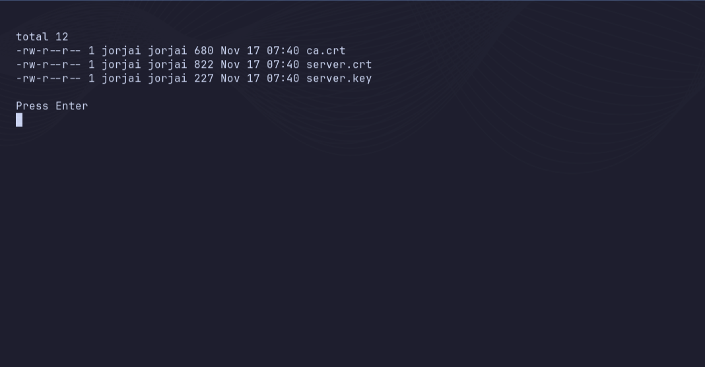
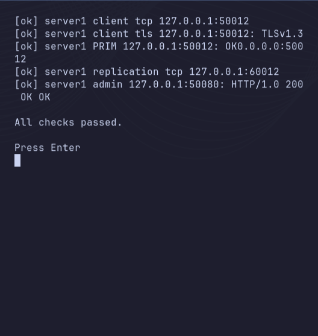
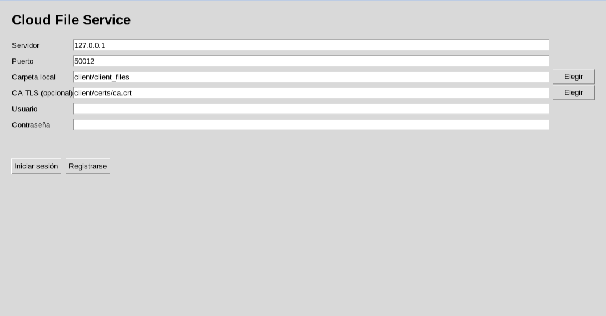

# Installation Guide

This guide installs Cloud File Service on independent Linux machines. It covers a
single server and a replicated cluster. No virtual machine is required; the same
steps apply to physical machines, containers, or virtual machines.

The guide targets Ubuntu 22.04 and Python 3.10.12. Python 3.10 is end-of-life,
so this guide is intended for the laboratory demonstration. A production
deployment must migrate to a supported Python release.

## Prerequisites

- Ubuntu 22.04 on each node.
- The self-contained Linux bundles, or the repository and a Python 3.10.12
  virtual environment.
- A fixed IP address for each server.
- Open firewall ports between the nodes.
- A browser that can import a private CA, or a browser where the certificate
  warning can be accepted once.
- No Internet access is required after the bundles, certificates, and
  configuration are copied.

## Network layout

Use fixed IP addresses. The example below uses three servers and two clients:

| Node | Role | Example IP |
| --- | --- | --- |
| `server1` | Primary | `192.168.1.101` |
| `server2` | Secondary | `192.168.1.102` |
| `server3` | Secondary | `192.168.1.103` |
| `client1` | `alice` | `192.168.1.111` |
| `client2` | `bob` | `192.168.1.112` |

The same steps also work for one server and one client. Replace every example IP
with the real laboratory IP addresses.

## Firewall

Allow these ports from the laboratory subnet on each server:

```sh
sudo ufw allow from 192.168.1.0/24 to any port 50012 proto tcp
sudo ufw allow from 192.168.1.0/24 to any port 60012 proto tcp
sudo ufw allow from 192.168.1.0/24 to any port 50080 proto tcp
```

| Port | Purpose |
| ---: | --- |
| `50012` | Client protocol |
| `60012` | Replication |
| `50080` | HTTPS admin panel |

On Windows, create equivalent inbound rules with `New-NetFirewallRule`.

## Certificates

Generate one CA and one server certificate with every server IP as a SAN:

```sh
python scripts/generate_dev_cert.py --output certs \
  --host 192.168.1.101 \
  --host 192.168.1.102 \
  --host 192.168.1.103 \
  --host localhost \
  --host 127.0.0.1
```



Copy to each server:

```text
certs/ca.crt
certs/server.crt
certs/server.key
```

Copy only `certs/ca.crt` to each client. Keep `server.key` only on the servers.

If the IP addresses change, regenerate the certificate. The laboratory CA is a
development CA and must not be used for a production deployment.

## Generate the configuration

Run the generator with the fixed IPs:

```sh
python scripts/demo_lan_config.py \
  --server server1@192.168.1.101:50012:60012:50080 \
  --server server2@192.168.1.102:50012:60012:50080 \
  --server server3@192.168.1.103:50012:60012:50080 \
  --client alice@192.168.1.111 \
  --client bob@192.168.1.112 \
  --output demo/lan
```

For one server, use a single `--server`. For several servers on one PC, give each
instance different client, replication, and admin ports.

The generated layout contains:

- `server-<id>/`: `config.toml`, `files/`, certificates, and `run-server.sh`;
- `client-<name>/`: `config.toml`, `client_files/`, `state/`, CA, and run scripts;
- `certs/`;
- `RUNBOOK.md`;
- `demo-accounts.txt`;
- `cluster-token.txt`.

Do not commit `demo/lan/`: it contains private keys and demo passwords.

## Start the servers

On each server PC, extract the server bundle, copy the corresponding generated
server directory, and run:

```sh
export CLOUDFS_SERVER_BUNDLE=/path/to/cloud-file-server
cd server-server1
./run-server.sh
```

Start the primary first, then the secondaries. The startup script sets
`CONFIG_FILE` and the bootstrap administrator passwords.

Expected output:

```text
Servidor TLS 0.11.3 escuchando en el puerto 50012 (rol primary).
```

Secondary output:

```text
Servidor TLS 0.11.3 escuchando en el puerto 50012 (rol secondary).
```


## Network check

Run the checker from each PC:

```sh
python scripts/demo_lan_check.py \
  --server server1@192.168.1.101:50012:60012:50080 \
  --server server2@192.168.1.102:50012:60012:50080 \
  --server server3@192.168.1.103:50012:60012:50080 \
  --ca demo/lan/certs/ca.crt
```

Expected result:

```text
[ok] server1 client tcp 192.168.1.101:50012
[ok] server1 client tls 192.168.1.101:50012: TLSv1.3
[ok] server1 PRIM 192.168.1.101:50012: OK192.168.1.101:50012
[ok] server1 replication tcp 192.168.1.101:60012
[ok] server1 admin 192.168.1.101:50080: HTTP/1.0 200 OK OK
...
All checks passed.
```



Use `--client-cert`, `--client-key`, and `--token` to also test the replication
handshake.

## Start the clients

On each client PC, extract the client bundle and copy the corresponding
generated client directory into the bundle directory. Then run:

```sh
export CLOUDFS_CLIENT_GUI_BUNDLE=/path/to/cloud-file-client-gui
cd client-alice
./run-client.sh
```

The GUI opens with the bundled configuration and CA. The compact kit does not
include the system tray; closing the window minimizes it.



Use `run-client-cli.sh` for a CLI-only client.

## Accounts

Open the admin panel on any server:

```text
https://192.168.1.101:50080/
https://192.168.1.102:50080/
https://192.168.1.103:50080/
```

Log in as `sar` or `sza` using the passwords from `RUNBOOK.md`. Create `alice`
and `bob` from the primary panel. Registration remains enabled for the demo.


The admin panel on a secondary shows the cluster status and redirects mutations
to the primary admin URL. After a failover, open the new primary or use a
secondary redirect. Admin sessions are local to each node.

## Demo script

1. Start the three servers.
2. Run the network checker.
3. Open the admin panel on the primary.
4. Create `alice` and `bob`.
5. Start the two clients.
6. Upload a file from `alice`.
7. Share the file or directory with `bob` as `rw`.
8. Verify that `bob` receives the shared file.
9. Modify the shared file from `bob`.
10. Verify that `alice` receives the notification.
11. Compare the three state hashes.
12. Stop the primary server.
13. Wait for election.
14. Upload after failover.
15. Restart the old primary.
16. Verify snapshot rejoin.
17. Repeat twice.

## Quorum and server counts

The quorum for `N` servers is `floor(N / 2) + 1`:

- 1 server: standalone, no failover;
- 2 servers: quorum 2, so there is no failover when one node stops;
- 3 servers: recommended;
- more than 3: supported, but use an odd number for the best fault tolerance.

## Troubleshooting

- **TLS error:** verify that every server IP is in the certificate SAN and that
  the client uses the generated `ca.crt`.
- **Connection refused:** check the server process, firewall, and generated
  ports.
- **Secondary admin redirect:** set `admin_addresses` to browser-reachable URLs.
- **No primary:** check `PRIM`, server logs, and the cluster token.
- **Tray missing:** the compact kit minimizes to the taskbar; the full GUI
  bundle still contains the tray.
- **Bundle fails on Ubuntu 22.04:** rebuild it with
  `scripts/build_demo_bundles.sh`; do not use a bundle built on a newer glibc.

## Notes

- Python 3.10 is end-of-life. This guide targets the laboratory environment and
  the Ubuntu 22.04 demo only.
- The offline kit is a separate single-ZIP variant for one machine.
- The admin panel is HTTPS-only and uses the same server certificate.
