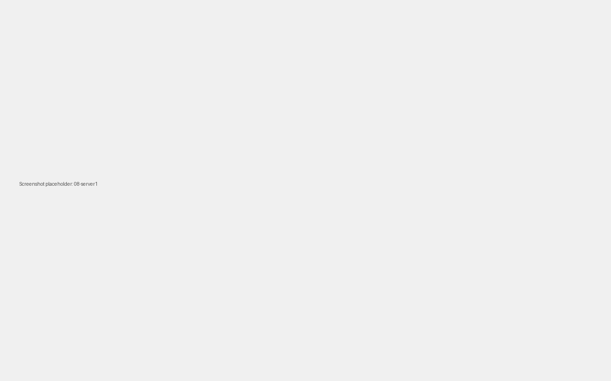
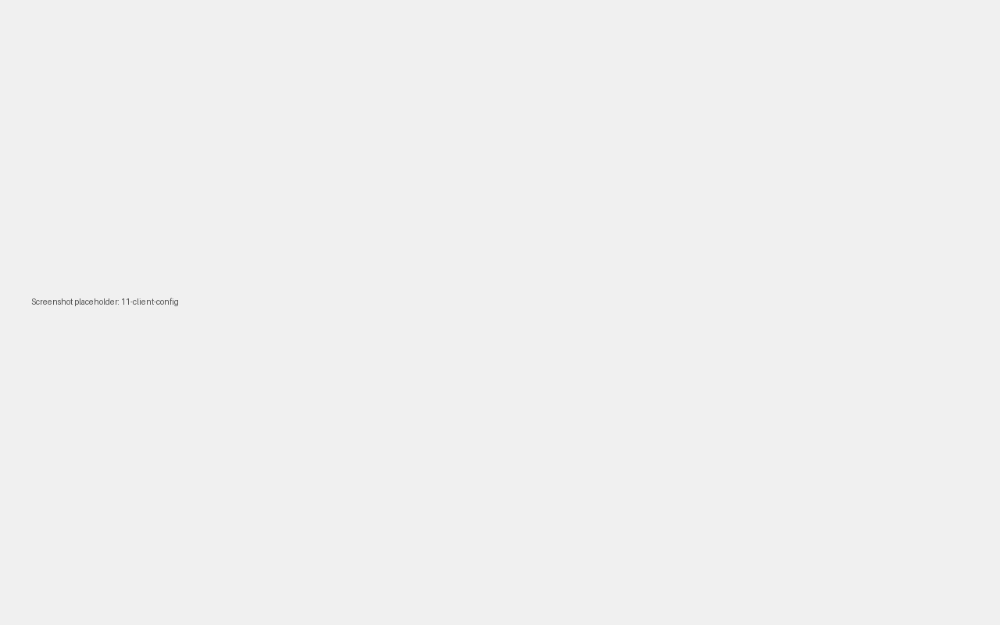
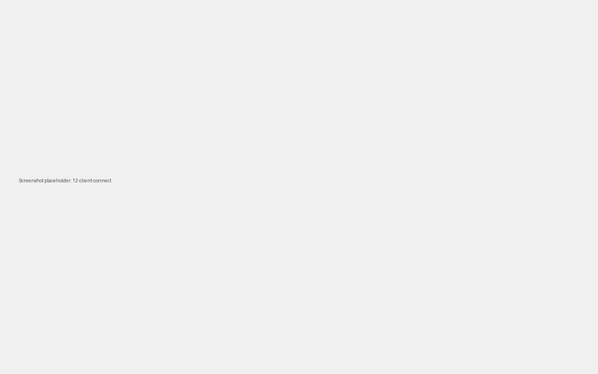
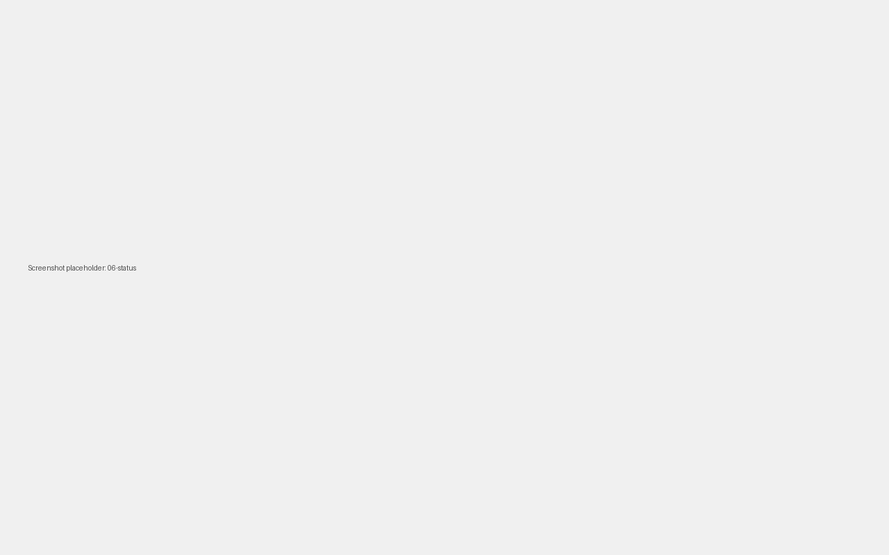
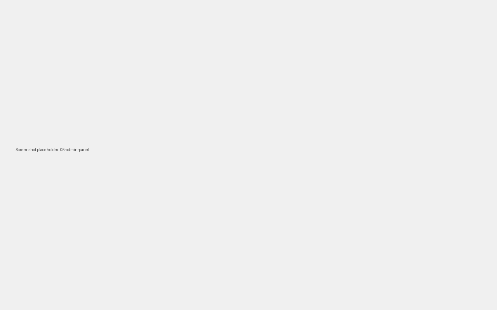

# Laboratory Walkthrough

This walkthrough reproduces the course demonstration on three machines with
no root access. It uses the offline kit and the `cloudfs setup` command.
Screenshots are captured on a Kubuntu 22.04 desktop at 1280x800.

## Before you start

- Three machines with fixed addresses `192.168.1.101`, `.102`, `.103`.
- The `CloudFS-Offline-0.12.0-linux-x64.zip` kit on a USB stick.
- A terminal on each machine.

## Step 1 - Extract the kit

On every machine:

```sh
unzip CloudFS-Offline-0.12.0-linux-x64.zip -d ~
cd ~/CloudFS
```


## Step 2 - Generate the cluster bundle (on machine 1)

```sh
./cloudfs setup --cluster 192.168.1.101,192.168.1.102,192.168.1.103
```

Save the printed administrator password.


## Step 3 - Copy the node directories

Copy `cluster/server2` to machine 2 and `cluster/server3` to machine 3
(USB stick or `scp`).

## Step 4 - Start the servers

Machine 1 (primary):

```sh
./cloudfs server --config cluster/server1/config.toml
```



Machine 2:

```sh
./cloudfs server --config cluster/server2/config.toml
```


Machine 3:

```sh
./cloudfs server --config cluster/server3/config.toml
```


## Step 5 - Client configuration (on a client machine)

```sh
cat > config/client.toml <<'EOF'
[client]
server = "192.168.1.101"
port = 50012
local_path = "client_files"
tls_ca_file = "certs/ca.crt"
tls_server_name = ""
state_dir = "state"
peers = "192.168.1.101:50012,192.168.1.102:50012,192.168.1.103:50012"
EOF
cp cluster/server1/certs/ca.crt certs/ca.crt
```



## Step 6 - Start the client and log in

```sh
./cloudfs client
```

Log in as `sar` with the password from step 2.



## Step 7 - Verify

```sh
./cloudfs status
```

Expected: `PRIM: OK192.168.1.101:50012` and `Panel: HTTP 303 See Other`.



## Step 8 - Failover

Stop the primary on machine 1 (`Ctrl+C`). Wait five seconds, then on any
machine:

```sh
./cloudfs status
```

It reports a different primary. Upload a file from the client. Restart
machine 1; it rejoins as a follower.


## Step 9 - Admin panel

Open `https://192.168.1.101:50080/` in a browser, accept the private CA
warning, log in as `sar` and create `alice` and `bob`.



## Capture checklist

Replace each placeholder in `docs/assets/lab/` with a real screenshot
(1280x800, PNG, English desktop, no black borders):

- `01-extract.png` - terminal after unzip, `cd ~/CloudFS`.
- `02-setup.png` - `./cloudfs setup --cluster ...` output with credentials.
- `08-server1.png`, `09-server2.png`, `10-server3.png` - server startup lines.
- `11-client-config.png` - editor with `config/client.toml`.
- `12-client-connect.png` - GUI login window.
- `06-status.png` - `./cloudfs status` output.
- `13-failover.png` - status after the primary stops.
- `05-admin-panel.png` - admin dashboard.
