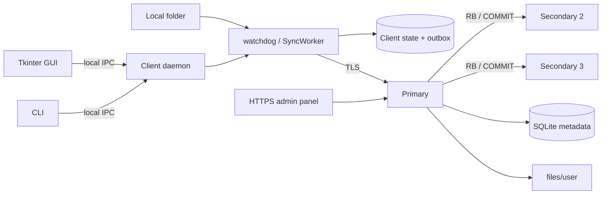

# Final Report: Cloud File Service

**Authors:** Jorge Arévalo Fernández, Jon Gonzalez Fernandez, Anne Baquedano Mella, Laura Rodríguez Rodríguez

**Course:** Distributed Systems, Bachelor's Degree in Informatics Engineering

## 1. Problem and objectives

The project builds a proof-of-concept cloud file service: a local folder is
synchronized transparently with a server, several clients can share files, and
the server survives the failure of its primary replica. The work follows the
three increments proposed in the course:

1. a client that hides the network and keeps a remote copy of a local folder;
2. a fault-tolerant server replicated with passive replication, a reliable
   broadcast, failure detection, and election;
3. file sharing between clients with server-initiated notifications.

The objective is not a commercial product. It is a working demonstration of the
distributed-systems mechanisms, with explicit decisions and an honest account of
what remains unfinished.

## 2. Distributed-system properties

The system consists of independent client and server processes that communicate
only by messages. Clients do not share memory with the server and may run on
different machines or containers.

- **Access transparency:** users work with ordinary files in a local folder.
- **Location transparency:** the client discovers the current primary through
  the `PRIM` command and a list of seed endpoints.
- **Replication transparency:** clients do not choose a replica; they send
  mutations to the primary, which obtains a 2/3 quorum.
- **Concurrency:** the server handles one thread per client and serializes
  mutations at the primary.
- **Fault tolerance:** committed operations survive a primary crash; a new
  primary is elected and a returning node receives a snapshot.
- **Sharing:** owners grant `ro`/`rw` access to other users, and active clients
  receive change notifications.

The implementation deliberately does not attempt Byzantine fault tolerance,
arbitrary network partitions, or a complete commercial security model.

## 3. Architecture



### Client

`SyncWorker` watches the local folder with `watchdog`. Events are coalesced and
written to a durable SQLite outbox before execution. At startup it reconciles
the server manifest with its last known state:

- uploads new or locally modified files;
- downloads missing or remotely modified files;
- applies tombstones;
- preserves both versions when local and remote content changed.

Owned files stay at the root of the local folder; shared files are mounted under
`shared/<owner>/<path>`. `ClientState` stores the last known revision, hash,
size, deleted flag, and access for every path.

`ClientSession` implements the TLS protocol, `PRIM` redirection, registration,
login, manifest, upload/download, and share commands. `RemoteWatcher` keeps a
separate authenticated subscription connection and feeds `UPDT` messages into
the synchronization worker.

### Server

`ServerRuntime` owns the TLS listener and accepts one connection per thread. A
`ReplicationServer` listener handles cluster traffic. `FileStore` keeps metadata
in SQLite and file contents under `files/<user>/`; uploads are written to a
temporary file and moved with `os.replace`. Paths are normalized and checked
with symlink-aware resolution.

The primary applies all mutations through `ServerRuntime.commit_operation`.
That method replicates the operation and applies it only after it obtains a
quorum. The `NotificationHub` publishes notifications after the local apply.

### Replication and election

The primary assigns a log index to each deterministic operation. It sends `RB`
messages over mutual TLS, waits for ACK from a majority, appends a committed
entry, applies the operation, and sends `COMMIT`. Each secondary persists
proposals and applies only committed entries in order. Without a quorum the
primary aborts the proposal and returns `ER12`.

`ClusterNode` sends heartbeats. A follower starts an election after the failure
timeout; votes require a majority and a candidate whose `(last_term, last_index)`
is at least as recent as the voter's log. A higher term fences an old leader. A
restarted node that is behind receives a `SNAP` snapshot from the leader.

### Sharing and notifications

Shares are stored in a replicated `shares` table. The owner always has implicit
`rw`; self-shares and the anonymous user are rejected. A stale write or delete
creates a conflict copy, and the client keeps the two versions. The primary's
`NotificationHub` sends `UPDT` messages to the owner and matching grantees,
excluding the client that originated the change. Active clients apply updates
immediately; offline clients reconcile on the next start.

### Desktop client and administration

The Tkinter GUI and CLI control a per-user daemon over authenticated local IPC.
The daemon owns the single synchronization worker, so closing the GUI to the
tray does not stop synchronization. Settings use the standard per-user config
directory. The optional HTTPS admin panel exposes users, shares, registration
settings, replication status, active sessions, and a demo-only primary
step-down. Admin mutations use the same replicated path as client mutations.

## 4. Design decisions

- **TLS is mandatory.** `tls.py` creates strict contexts, and the server refuses
  to start without a certificate/key. There is no plaintext fallback.
- **Deterministic operations.** The primary computes revision, hash,
  `mtime_ns`, conflict names, and data before replication. `FileStore.apply_operation`
  never recalculates them on a secondary.
- **Durable log.** `ReplicationLog` persists `(term, index, payload, committed)`
  and the commit index, allowing restart and rejoin. See `replication.py`.
- **Quorum before apply.** `Replicator.replicate` broadcasts and commits only
  after a majority; see `replication.py:Replicator`.
- **Conflict preservation.** `FileStore.plan_put_with_conflict` and
  `plan_delete_with_conflict` keep the current server version as a conflict
  file instead of overwriting it silently.
- **Election safety.** `election.py:ClusterNode` checks terms, persists votes,
  compares logs, and fences leaders that lose quorum.
- **Client transparency.** `SyncWorker.reconcile` uses the last state as a
  three-way base; `RemoteWatcher` closes the gap between active notifications
  and offline reconciliation.
- **Local IPC.** `ipc.py` uses a Unix socket or Windows named pipe and an authkey
  file with mode `0600`; no local TCP port is opened.
- **Admin safety.** `admin_service.py` prevents self-disable and disabling the
  last enabled admin; `server_admin.py` uses `HttpOnly`/`SameSite=Strict`/`Secure`
  cookies and CSRF tokens.
- **Small dependency set.** The server and client use the standard library plus
  `watchdog`, `trustme` for development certificates, and `pystray`/`Pillow` for
  the optional tray.

## 5. Implementation map and data model

| Module | Responsibility |
| --- | --- |
| `tls.py` | Strict client/server TLS contexts |
| `szasar.py` | Protocol constants, framing, path encoding |
| `config.py` | TOML/environment configuration and standard paths |
| `file_store.py` | SQLite metadata, files, users, shares, settings, ACL |
| `replication.py` | Durable log, mTLS replication, quorum coordinator |
| `election.py` | Heartbeats, terms, election, fencing, step-down |
| `server_runtime.py` | TLS server, sessions, protocol wiring, admin status |
| `notification_hub.py` | Subscription registry and `UPDT` delivery |
| `client_state.py` | Client metadata and durable outbox |
| `client_session.py` | Client TLS protocol session and `PRIM` |
| `sync_client.py` | Watcher, reconciliation, retries |
| `remote_watcher.py` | Client notification connection |
| `daemon_service.py` / `ipc.py` | Background daemon and local IPC |
| `gui_app.py` / `gui_fich.py` | Tkinter GUI, tray, autostart |
| `admin_service.py` / `server_admin.py` | Replicated admin operations and HTTPS panel |

The main tables are:

```sql
users(username, password_hash, salt, iterations, role, disabled, created_at)
files(owner, path, rev, hash, size, mtime_ns, deleted)
shares(owner, path, grantee, access, created_at)
settings(key, value)
```

Client state mirrors file metadata and adds an outbox. The replication log is a
separate SQLite database with `entries(term, idx, payload, committed)` and a
`meta` table.

## 6. Tests and results

All tests are standard-library `unittest` tests. They use temporary directories,
ephemeral ports, and `trustme` certificates.

```sh
python -m unittest discover -s tests -v
python -m ruff check .
mkdocs build --strict
```

At the time of writing, the suite contains **177 tests**, all passing. The
coverage includes:

- configuration precedence, TLS rejection, path traversal and symlink checks;
- file storage, revisions, tombstones, conflict copies, snapshots and state
  hashes;
- reconciliation of owned and shared files, durable outbox, and conflict rules;
- three-replica convergence, quorum rejection, snapshots and replication logs;
- failover election, client redirection with `PRIM`, rejoin and post-failover
  notification;
- sharing ACLs, notification delivery, revocation and offline reconciliation;
- daemon IPC, GUI controller actions, single instance, autostart and HTTPS admin
  sessions/CSRF.

Measured results:

| Property | Result |
| --- | --- |
| Replica convergence | Three replicas reach the same `state_hash` after mutations |
| Failover | Local demo elects a secondary well under the 5 s target |
| Post-failover upload | Committed and visible in the new primary |
| Rejoin | Old primary converges through snapshot |
| Notifications | Delivered to an active owner/grantee in under 2 s in tests |
| Admin | HTTPS `/healthz` OK on all three Compose nodes |

The GUI and tray were exercised through the controller/IPC layer, automated
tests, and a PyInstaller bundle. A real desktop session is still required for
the final visual and tray checklist because CI is headless.

## 7. Reproducible demo

`scripts/demo_failover.py` (or `scripts/demo.sh`) starts three real server
runtimes and two synchronization clients, registers two users, uploads and
shares a file, stops the primary, waits for election, uploads again, restarts
the old primary, and verifies state hashes.

`scripts/demo_docker.sh` performs the same flow with the Compose cluster and
client containers, including the three-node health check and the final hash
comparison.

The expected final line reports the same state hash on all three servers.

## 8. Limitations and work remaining

- The system is a crash-stop proof of concept; it does not tolerate Byzantine
  nodes or arbitrary network partitions.
- There is no version history, tombstone garbage collection, or chunked
  transfer for very large files; snapshots are a single replication message.
- The client supports Windows and Linux; macOS and signed native installers are
  out of scope. Portable bundles are unsigned.
- The GUI depends on Tkinter and a desktop session; tray support depends on the
  desktop's status-notifier implementation.
- The admin panel has no login rate limiting, email password reset, user
  deletion, or persistent audit log.
- Passwords are kept in memory by the daemon; there is no OS keyring or
  self-service recovery.
- There is no automatic update mechanism or release code signing.
- There is no cross-user group model beyond individual `ro`/`rw` shares.

These limitations are intentional scope decisions and are also documented in
`docs/limitations.md`.

## 9. Conclusions

The project demonstrates the complete lifecycle of a distributed file service:
transparent client synchronization, revisioned metadata, passive replication
with quorum, failure detection and election, snapshot-based rejoin, cross-user
sharing with notifications, and practical client/admin interfaces. The most
important result is not a feature checklist but the explicit treatment of
failure: the system defines what is committed, how a leader is fenced, and how
a returning replica converges.

With more time, the next steps would be TLS deployment automation, durable
admin audit logging, rate limiting, chunked snapshots, version history, and
signed installers for end users.

## 10. References

- Course notes, slides, and project statement in `docs/ref/`.
- Course guide, `docs/ref/guia_docente_DS_2026_27_eng.pdf`.
- Bibliography, `docs/ref/bibliography.pdf`.
- Amazon Dynamo and the replication/consensus articles included in
  `docs/ref/Other documents-20261020/`.
- Python documentation for `ssl`, `sqlite3`, `http.server`, and `tkinter`.
