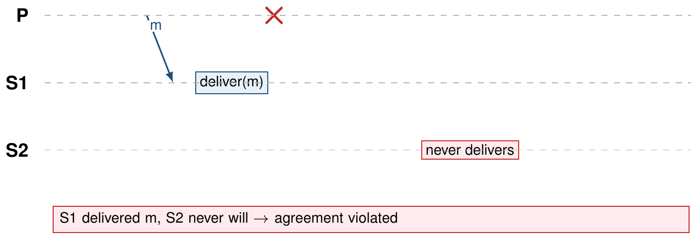
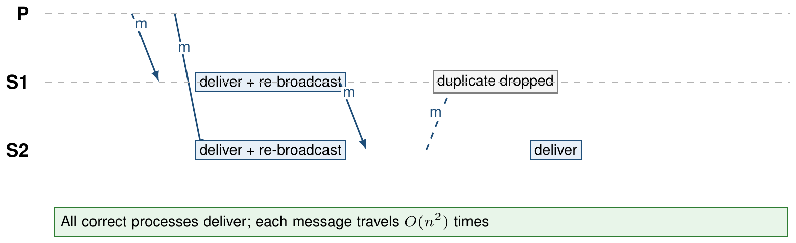

## Introduction

The primitive operates on a closed group `G = {P1, …, Pn}` (Notes, Topic 3,
§3.4.1). The processes communicate through `send()`/`receive()`, and the group
communication layer offers `broadcast(G, m)` and `deliver(m)`. Failures are
crash or stop failures: a faulty process does not recover. The channels are
**quasi-reliable**: a correct process eventually receives every message sent
by another correct process. This is weaker than a reliable channel, because if
the sender fails right after sending, the message may never reach anyone.

The service that we have to support is the passive replication of the cloud
file service. The primary sequences the requests and the secondaries apply the
updates in the order in which they arrive. What the primary needs from the
communication layer is that either all correct secondaries apply an update or
none does. That is exactly the **all-or-none** property of reliable broadcast.

## Simple broadcast: does it provide reliable broadcast?

The simple protocol of the notes is the following:

```
broadcast(G, m):
    for each Pj in G:
        send(Pj, m)

upon receive(m) at Pj:
    deliver(m)
```

We analyse it against the three properties of reliable broadcast
(Notes, §3.4.2.1):

- **Validity.** If a correct process `Pi` broadcasts `m`, then `Pi` eventually
  delivers `m`. The sender includes itself in the group and the channels are
  quasi-reliable, so it receives and delivers the message. **Satisfied.**
- **Integrity.** Every process delivers `m` at most once and only if `m` was
  previously broadcast. The protocol delivers only messages received through
  `broadcast()`, and each reception is delivered once. **Satisfied.** (In a real
  implementation, duplicate suppression needs a message identifier.)
- **Agreement.** If a correct process delivers `m`, then all correct processes
  eventually deliver `m`. **Not satisfied.** The sender may fail in the middle
  of the loop: some processes receive `m` and deliver it, while the rest never
  receive it. The quasi-reliable channel does not help here, because the
  sender is no longer correct.

{width=5.2in}

The protocol therefore provides **unreliable broadcast**: validity and
integrity hold, but agreement does not. It is not enough to support passive
replication, because a secondary could apply an update that another secondary
never receives, and the replicas would diverge.

## The R-broadcast / R-deliver protocol

The protocol proposed in the notes adds a re-broadcast step: every process
that receives a message for the first time forwards it to the rest of the
group before delivering it.

```
R-broadcast(G, m):
    broadcast(G, m)                 # first dissemination

upon receive(m) at Pj:
    if m not in received:           # first reception only
        received.add(m)
        if sender(m) != Pj:
            broadcast(G, m)         # forward to the whole group
        R-deliver(m)
```

A message is identified by `(sender, sequence number)`, so duplicates are
recognised and dropped. The sender executes `R-deliver(m)` when it processes
its own broadcast, and this preserves validity.

**Does it satisfy reliable broadcast?**

- **Validity.** If a correct `Pi` R-broadcasts `m`, it broadcasts to every
  process and, being correct, it delivers its own message. **Satisfied.**
- **Agreement.** If a correct `Pj` R-delivers `m`, then `Pj` received `m` and,
  before delivering it, re-broadcast it to every process. Since `Pj` is
  correct, the quasi-reliable channels deliver the re-broadcast to every
  correct process, which will deliver `m` on first reception. **Satisfied.**
- **Integrity.** A process delivers only on the first reception of a message
  that was actually broadcast, and never twice thanks to the `received` set.
  **Satisfied.**

The protocol provides reliable broadcast, so it provides the all-or-none
property that passive replication requires.

{height=4.6in}

**Price paid**

The guarantee is not free:

- **Message amplification.** Every process re-broadcasts every message once,
  so a single R-broadcast generates up to `n·(n−1)` messages, that is,
  **O(n²)** instead of O(n). Each process receives up to `n−1` copies of the
  same message.
- **Duplicate suppression.** The protocol needs message identifiers and a set
  of already received messages. Without garbage collection this set grows
  without bound. With bounded identifiers, the window has to be large enough
  to cover the maximum network delay.
- **Latency.** Delivery requires at least two rounds in the worst case (the
  original broadcast plus a re-broadcast), and a process cannot deliver
  before it has forwarded the message.
- **No ordering.** Reliable broadcast says nothing about the order of
  delivery. Passive replication does not need it, because the primary
  sequences the updates, but active replication would additionally need FIFO,
  causal or total order, which is more expensive.

## Why passive replication needs reliable broadcast

The primary sequences the requests, so the order property is already solved on
the primary side. What remains is atomicity: an update has to reach every
correct secondary, or none. If the primary sends the update with plain
`broadcast()` and fails after reaching only some secondaries, those
secondaries apply an update that the others never see, and the replicas
diverge. Reliable broadcast closes exactly that gap: either all correct
secondaries eventually deliver the update or none does.

Reliable broadcast alone does not give linearizability to the client yet. It
guarantees eventual delivery to all correct processes, but not that the
primary knows when they have delivered. For that reason the primary also waits
for the acknowledgements before responding. The ACK barrier is the additional
condition that turns reliable broadcast into the atomicity observed by the
client (see Activity 3.1c, Proposition 2b).

## Integration in the cloud file service

The Project implements the same idea with a star topology. The primary sends
each mutation as a deterministic operation (revision, hash, size, `mtime`,
conflict name and data) to every secondary over mutual TLS, waits for a
two-thirds quorum of acknowledgements, appends the committed entry to its
durable log, applies it locally and sends `COMMIT`. The secondaries apply only
committed entries, in order. A secondary that rejoins receives a snapshot and
the missing log entries.

This differs from the academic `R-broadcast()` in two ways. First, there is no
re-broadcast step: the primary has a direct channel to every secondary, so the
first dissemination already covers the whole group, and a secondary never
forwards to another secondary. Second, the primary waits for a quorum of ACKs
before replying, which is stronger than reliable broadcast and is what
provides durability and linearizability. The re-broadcast of `R-broadcast()`
is the general solution when the sender does not have a direct channel to
every process, or when the sender may crash during the first dissemination. In our star topology, the durable log and the snapshot cover recovery from that
case.

## Conclusions

The simple `broadcast()`/`deliver()` protocol is not reliable broadcast: it
satisfies validity and integrity, but not agreement. The `R-broadcast()` /
`R-deliver()` protocol restores agreement by re-broadcasting every message on
first reception, at the price of O(n²) messages, duplicate suppression and an
extra round. This is enough for passive replication, where the primary
provides the order. The ACK barrier is then added to give the client
linearizability. The Project implements the star-topology version of the same
idea, with a durable log, quorum commit and snapshot-based recovery.

## References

- Lafuente, A., Larrea, M. *Distributed Systems*, course notes, Topic 3,
  §3.4.1 (system model) and §3.4.2.1 (reliable broadcast).
- Activity statement 3.2a, Part 3, course HTML (P03).
